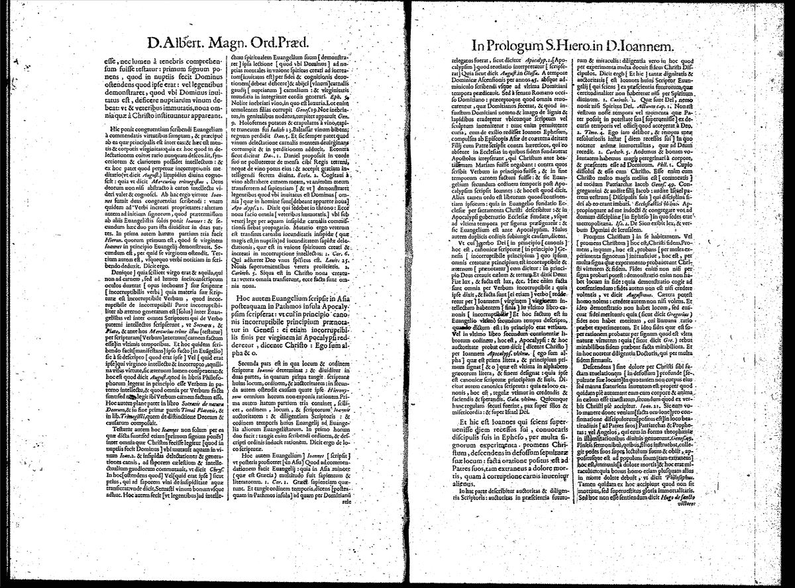
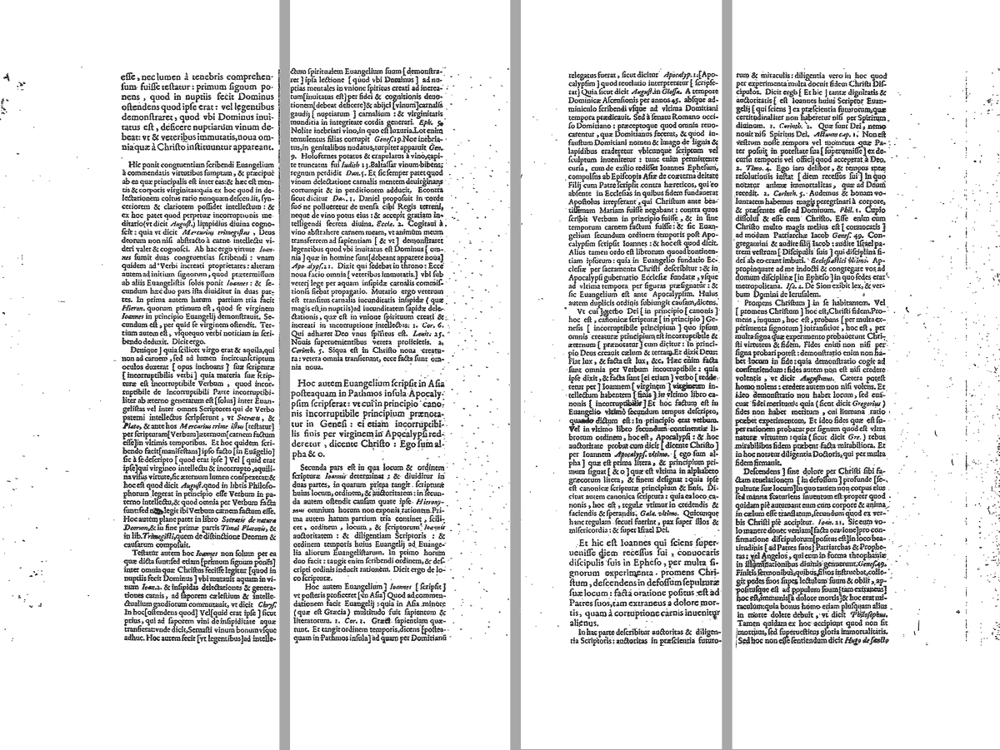

# recto

[](https://github.com/chriscruz06/recto/actions/workflows/test.yml)

Cleans scanned early-modern book spreads into OCR-ready column images.

A scanned page of a hand-press book is often a photograph of a two-page
spread, and the text of each page is set in columns. An OCR engine that reads
that image reads straight across all the columns, and the result looks like
Latin but is not the text. Recto cuts each spread into one clean image for
each text column, and writes a manifest that says where each image came from.

It is the first stage of an OCR pipeline for a translation of Albertus Magnus,
*Super Iohannem*, in the Jammy edition (Lyons, 1651, *Operum Tomus
Undecimus*). Every constant in it was measured on that scan.



*Before: one PDF page of the scan. It holds a spread of two pages with two
columns each, the running heads, the dark gutter and a catchword.*



*After: the four column images that `recto run` writes from that page, side by
side. The running heads, the gutter and the catchword are gone.*

## What it does

Each PDF page goes through ten stages, in this order:

1. **crop-border** removes the black frame of the scan. It measures each edge
   by itself, because the frame is not the same width on each side.
2. **despeckle** removes ink components smaller than a full stop.
3. **split-spread** finds the gutter as the darkest band near the middle and
   cuts the spread into a verso and a recto.
4. **drop-blank** skips blank pages and records them.
5. **deskew** straightens each page by itself. The two halves of one spread
   can lean by different amounts.
6. **mask-figures** whites out woodcuts, decorated initials and ornaments.
7. **strip-head** removes the running head and the folio number.
8. **strip-foot** removes the catchword, the signature mark and the direction
   line.
9. **band-lines** finds the text lines. It only draws them for the debug
   overlays. The other stages call the same function.
10. **split-columns** cuts each page into its columns with a straight cut that
    can slant. A title block that runs across both columns stays whole.

On the four parts of the volume, 304 PDF pages give 555 page images.

## Install

Python 3.11 or newer.

```powershell
git clone https://github.com/chriscruz06/recto.git
cd recto
python -m venv .venv
.venv\Scripts\Activate.ps1
pip install -e ".[dev]"
recto --help
```

On Linux or macOS, activate with `source .venv/bin/activate`.

## Use

Clean a whole PDF:

```powershell
recto run book.pdf
```

The column images and `manifest.jsonl` go into `out\book\`. Each page prints
its frame count and its time. A page takes about two to four seconds.

Useful options:

- `--pages 9-12` does only some pages. Pages are one-based, as a PDF viewer
  numbers them. `9`, `8-10` and `1,4,7-9` are valid.
- `--resume` keeps the pages that an earlier run finished and does only the
  rest. Use it after a run stops, or to add pages.
- `--profile my-book.toml` sets the constants for another book (see
  [Profiles](#profiles)).
- `--debug` writes one overlay image for each stage under `work\debug\`, with
  what the stage found drawn on the page.

To see what each stage did to one spread:

```powershell
recto debug book.pdf --page 9
```

This writes the overlays of that page, and one HTML page that shows them in
order with the verso and the recto next to each other. Then it opens the HTML
page.

Rendered pages are cached under `work\raster\`, so a second run does not render
them again. `recto raster book.pdf --pages 9` only renders.

### Check the OCR gain

If [Tesseract](https://github.com/tesseract-ocr/tesseract) is on PATH with the
Latin language data, this compares its mean word confidence on the raw spreads
and on recto's column images:

```powershell
recto ocr-check book.pdf --pages 9-11
```

Tesseract reads each raw spread with its own layout analysis, and each column
as one column. On pages of this scan, the columns score 5.7 to 9.5 points
higher, from 0 to 100. Confidence is not accuracy, so this only shows that the
cleaning helps Tesseract. Tesseract takes about 15 seconds a page.

## The manifest

`manifest.jsonl` has one JSON object on each line: one for each column image,
and one for each skipped blank page. A row looks like this, with one stage
shown:

```json
{"image": "p0009-recto-c1.png", "label": "p0009-recto-c1",
 "source": "book.pdf", "page": 9, "side": "recto", "column": 0,
 "status": "column", "dpi": 300, "page_rows": 4,
 "width": 1157, "height": 4318,
 "stages": [{"stage": "strip-head", "frame": "p0009-recto",
             "summary": "running head stripped, rows 0 to 394, banded in both halves",
             "findings": [{"kind": "running-head", "box": [0, 0, 2727, 394],
                           "note": "cut at 394"}]}]}
```

- `page` is one-based. `column` is zero-based. A title block across the page
  is column 0, so the column index is the reading order on the page.
- `status` is `column`, `blank` for a skipped page, or `error` for a page where
  a stage failed. An error row holds the message in `error`, and the run goes
  on to the next page.
- `stages` holds what each stage reported: its summary, and its findings as
  boxes and lines. Each finding is in the coordinates of the frame that its
  stage was given, named in `frame`.
- The findings of despeckle and band-lines are left out, because there are
  hundreds on each page. Their summaries stay in.

Rows are in reading order. After `--resume`, the pages that the resume did
come after the others. Sort by `page` for the book order.

## Profiles

Every constant has a default in the code, measured on the Jammy scan.
`profiles/jammy-1651.toml` lists all 66 of them by stage, at their defaults:

```toml
[deskew]
search = 4.5
cap = 4.0

[split-columns]
clear = 6
```

To use recto on another book:

1. Make a new TOML file. Put in only the keys that must change. The code gives
   the default for every key that you leave out.
2. Run `recto debug book.pdf --page N` on a few typical pages, and on the pages
   that are not typical: the title page, a page with a woodcut, a chapter end.
3. Find the first stage whose overlay is wrong. Read its keys in
   [`docs/tuning.md`](docs/tuning.md). It says what each key does, and what was
   measured when the key moved up and down.
4. Change one key. Run `recto debug` again with `--profile`, and compare.

A wrong section, key or type stops the run, and the message lists the correct
ones. Lengths in a profile are pixels at 300 dpi. The stages scale them to the
resolution of each page.

## Tests

```powershell
python -m pytest
```

The tests use small fixtures under `tests/fixtures/`, made from part 1 of the
scan. `tests/make_fixtures.py` makes them again from the scan. Parts 2 to 4
were kept out of the fixtures on purpose, as a held-out set, and every fix
since the column split was checked on them.

The tests check the stages against labels set by eye. For example, they check
the row of each running head and foot row, and that letters keep 99 percent of
their ink. They do not compare against stored output images.

## Known limits

- **One book.** Every constant was measured on one volume. Another book will
  probably need a profile. The stages expect a bitonal scan of two-page spreads
  with two columns.
- **Speckle at the outer edge.** A strip of speckle down the outer edge of many
  rectos stays in the last column image. The after image above shows it.
- **Signature without a catchword.** On chapter ends, where the left column
  runs below the foot, recto finds the foot by its catchword, which is set
  flush right. On part 2 page 21 recto there is no catchword, so the signature
  P 3 stays.
- **Index rerum.** The column cut fails on the opening page of the Index rerum
  (part 3, page 37, recto).
- **Deskew.** On a page where the score is nearly flat, two machines can choose
  angles one 0.05 degree step apart.
- **No map to the scan.** A manifest row names the page, side and column. It
  does not map the column back to pixels of the scan.
- **No folio.** The printed page number is removed with the running head, and
  recto does not read it.

## License

MIT. See `LICENSE`.
